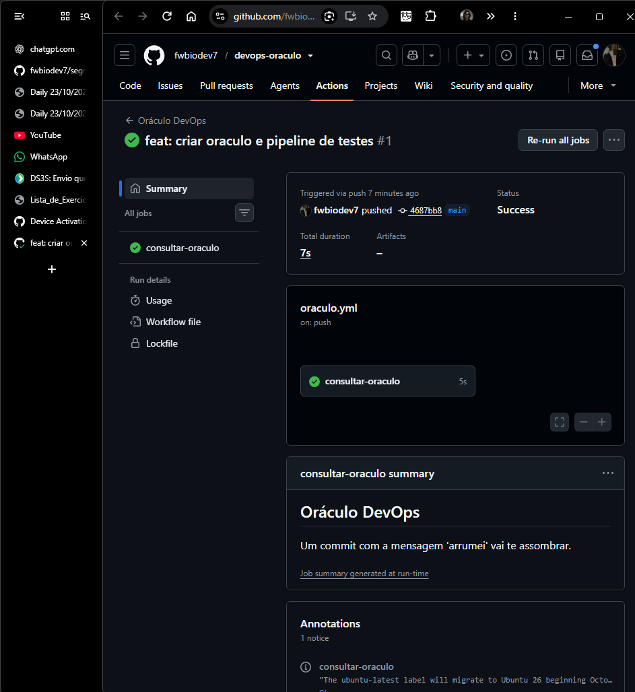

# Oráculo DevOps

[](https://github.com/fwbiodev7/devops-oraculo/actions/workflows/oraculo.yml)

Uma previsão do dia para programadores, com testes automáticos no GitHub Actions.

Projeto desenvolvido para a **Questão 4 — Prática: o Oráculo DevOps no GitHub Actions**. O objetivo é demonstrar integração contínua (**CI**): cada alteração enviada ao repositório passa por um pipeline de testes antes de o oráculo publicar sua previsão.

**[Ver execuções](https://github.com/fwbiodev7/devops-oraculo/actions) · [Consultar workflow](.github/workflows/oraculo.yml) · [Respostas da atividade](#respostas-da-atividade)**

## Como funciona

O programa usa `random.choice` para sortear uma das nove mensagens de `PREVISOES`. O GitHub Actions executa o código em um ambiente Linux com Python 3.12 e escreve a previsão no **Summary** da execução.

Toda a execução acontece no GitHub. Para acompanhar o projeto, basta uma conta no GitHub e um navegador.

### Estrutura do repositório

```text
devops-oraculo/
├── .github/
│   └── workflows/
│       └── oraculo.yml     # Eventos e etapas do pipeline
├── docs/
│   └── evidencias/         # Capturas reais da atividade
├── oraculo.py             # Lista de previsões e função consultar()
├── test_oraculo.py         # Validações com assert
└── README.md              # Documentação e respostas
```

O projeto usa somente a biblioteca padrão do Python, sem dependências externas para o programa ou os testes.

## Pipeline de integração contínua

O workflow **Oráculo DevOps** pode ser acionado por um `push`, pelo botão **Run workflow** ou pelo agendamento configurado.

| Ordem | Etapa | Função |
| --- | --- | --- |
| 1 | Baixar o código | Obter os arquivos com `actions/checkout@v5`. |
| 2 | Instalar o Python | Preparar o Python 3.12 com `actions/setup-python@v6`. |
| 3 | Rodar os testes | Executar `python test_oraculo.py`. |
| 4 | Consultar o oráculo | Executar o programa e enviar sua saída ao `$GITHUB_STEP_SUMMARY`. |

O arquivo [test_oraculo.py](test_oraculo.py) valida duas regras:

- A lista deve conter **pelo menos cinco previsões**.
- A mensagem sorteada por `consultar()` deve pertencer à lista `PREVISOES`.

Se um teste falhar, o passo termina com erro e a consulta do oráculo é pulada. Esse comportamento foi verificado na falha proposital descrita abaixo.

### Consultar uma previsão pelo navegador

1. Abra a aba **Actions** e selecione **Oráculo DevOps**.
2. Clique em **Run workflow**, mantenha a branch `main` e confirme a execução.
3. Aguarde o check verde e abra a execução.
4. No **Summary**, veja o quadro **Oráculo DevOps** com a mensagem sorteada.

Para visualizar o Summary completo e os logs, mantenha sua conta conectada ao GitHub.

## Evidências da prática

As três etapas foram executadas no GitHub Actions, com commits separados. A falha proposital permanece no histórico para demonstrar a atuação dos testes.

| Etapa | Alteração | Resultado real | Execução |
| --- | --- | --- | --- |
| Passo 5 | Versão inicial com seis previsões | Sucesso; previsão publicada no Summary | [Execução 1 — commit `4687bb8`](https://github.com/fwbiodev7/devops-oraculo/actions/runs/39945549670) |
| Passo 6 | Remoção de três previsões | Falha com `AssertionError: Poucas previsões!`; consulta pulada | [Execução 2 — commit `8196df6`](https://github.com/fwbiodev7/devops-oraculo/actions/runs/39945672784/job/120387612915) |
| Passo 7 | Restauração das seis previsões e adição de três novas | Sucesso após o conserto | [Execução 3 — commit `915b054`](https://github.com/fwbiodev7/devops-oraculo/actions/runs/39945877956) |

### PRINT 1 — sucesso inicial e previsão no Summary



### Três previsões adicionadas no conserto

- “Seu café vai acabar exatamente quando o pipeline ficar verde.”
- “Um conflito de merge vai testar sua paciência antes dos testes unitários.”
- “Hoje você vai descobrir que o TODO de ontem virou a tarefa de amanhã.”

## Respostas da atividade

### a) No Passo 6, o passo “Consultar o oráculo” chegou a ser executado? Por que isso é uma vantagem do CI?

Não. Na execução com apenas três previsões, o primeiro `assert` falhou com a mensagem `AssertionError: Poucas previsões!`. O passo **Rodar os testes** terminou com erro, e **Consultar o oráculo** foi marcado como `skipped` (pulado).

Essa é uma vantagem da integração contínua (**CI**): detectar automaticamente uma alteração que quebra uma regra do projeto e impedir que as etapas seguintes usem o código com erro. Em um pipeline com **CD**, os testes também podem servir como uma condição antes do **deploy**. Neste projeto, o pipeline demonstra a validação e a execução automática do programa.

### b) Cite uma situação real em que você usaria o GitHub Actions para automatizar algo.

Eu usaria em um projeto de site feito em grupo na escola. A cada `push`, um workflow executaria os testes e verificaria se o site consegue ser gerado. Depois da aprovação dos testes na branch principal, outro passo poderia fazer o deploy. Assim, o grupo perceberia os erros cedo e automatizaria tarefas repetitivas, aplicando práticas de **DevOps**.

## Desafio bônus — segunda a sexta às 8h de Brasília

O workflow inclui este agendamento dentro de `on:`:

```yaml
on:
  push:
  workflow_dispatch:
  schedule:
    - cron: "0 11 * * 1-5"
```

O cron usa UTC por padrão. Assim, **11h UTC correspondem a 8h de Brasília (UTC−3)**.

| Campo | Valor | Significado |
| --- | --- | --- |
| Minuto | `0` | No minuto zero |
| Hora | `11` | Às 11h UTC |
| Dia do mês | `*` | Qualquer dia do mês |
| Mês | `*` | Qualquer mês |
| Dia da semana | `1-5` | De segunda a sexta |

O agendamento usa o workflow da branch padrão, `main`, sem exigir um novo commit. O início pode sofrer atraso quando há maior carga no GitHub. A configuração está publicada; uma execução futura pelo agendamento ainda não foi observada nesta atividade.

## Fontes

- [GitHub Docs — sintaxe dos workflows e agendamento com cron](https://docs.github.com/en/actions/reference/workflows-and-actions/workflow-syntax#onschedule)
- [GitHub Docs — funções de verificação de status](https://docs.github.com/en/actions/learn-github-actions/expressions#status-check-functions)
- [GitHub Docs — evento schedule](https://docs.github.com/en/actions/reference/workflows-and-actions/events-that-trigger-workflows#schedule)

---

**Link do repositório para entrega:** [github.com/fwbiodev7/devops-oraculo](https://github.com/fwbiodev7/devops-oraculo).
